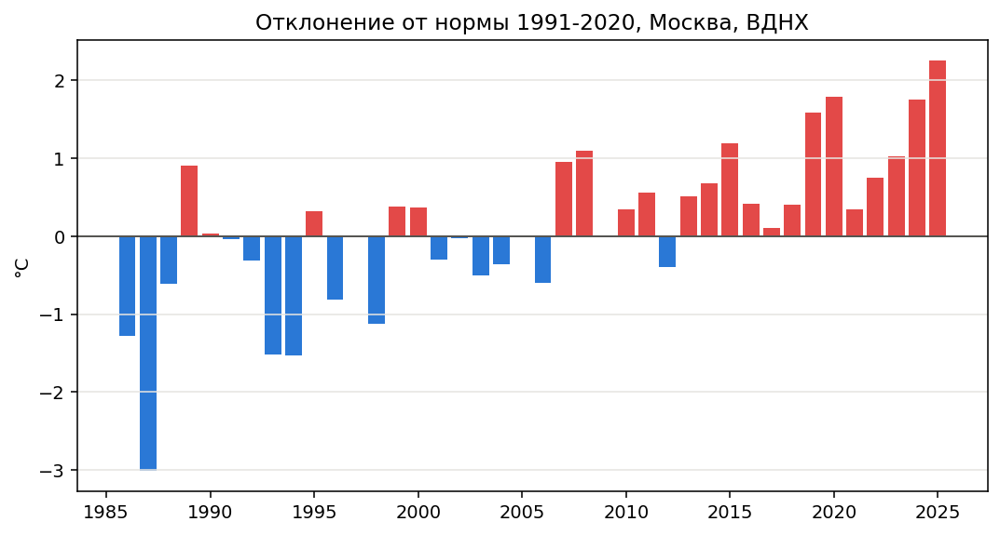
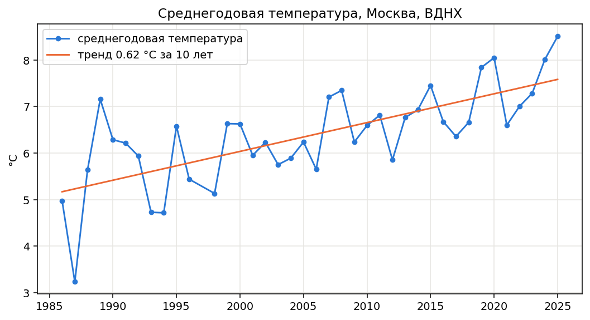
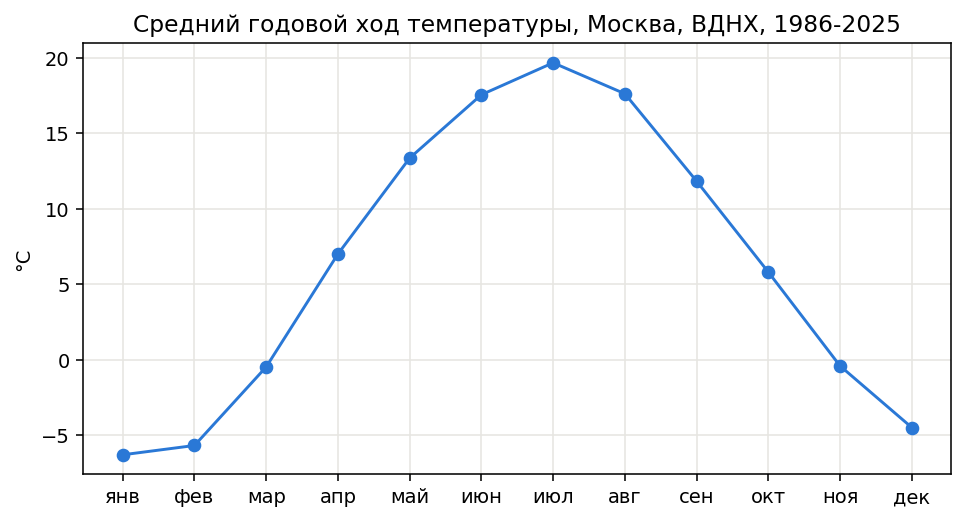
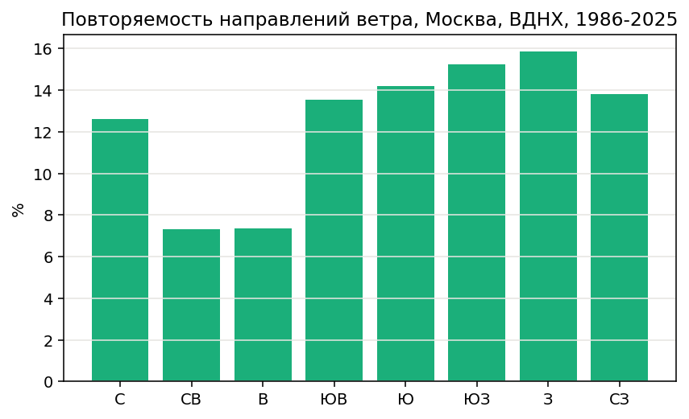

# Модуль для работы с архивами наблюдений АИСОРИ

Модуль читает выгрузки метеорологических наблюдений системы АИСОРИ
(ВНИИГМИ-МЦД, [meteo.ru](http://meteo.ru)) и считает по ним средние,
климатическую норму, аномалии и тренд.

Данные: станция **Москва, ВДНХ**, индекс ВМО 27612, 1986–2025 годы,
116 880 наблюдений по 8 сроков в сутки.



За сорок лет наблюдений среднегодовая температура растет на
**0,62 °C за десятилетие**. Красные столбцы — годы теплее нормы,
синие — холоднее. С 2013 года синих нет.

---

## Идея

Архив АИСОРИ нельзя открыть привычными средствами. Одна запись
выглядит так:

```
27612 1986  1  1  0 1986  1  1  3  2  3  2 21    10 10  8  8  0  2  0  600 …
```

Ни заголовков, ни разделителей. Пропущенное значение — пробелы, и
пробелы же разделяют поля. Даты записаны дважды: по Гринвичу и местные.
А `95` в поле видимости означает 2 километра, а не 95.

Модуль берет эту работу на себя. **Главное решение: ширины колонок не
зашиты в код, а читаются из файла `fld`, который приходит в той же
выгрузке.** Поэтому модуль подходит к любому архиву АИСОРИ — другой
станции, другому периоду, другому набору параметров.

Данные хранятся в словарях: ключ — имя колонки, значение — список
значений. Результаты расчетов тоже словари, например суточные средние
это `{(1986, 1, 1): -8.26}`, а годовые — `{1986: 4.98}`.

## Задачи

1. Прочитать описание полей и построить границы колонок.
2. Загрузить архив в словарь, пропуску сопоставить `None`.
3. Расшифровать кодовые поля: видимость, облачность, ветер.
4. Посчитать средние по суткам, месяцам и годам с контролем полноты.
5. Оценить климат: норма, аномалии, линейный тренд.
6. Выгрузить результат в обычный CSV для Excel и QGIS.

## Список авторов

| Участник | Что сделано |
|---|---|
| Панькова Полина | части 1 и 2 модуля: описание полей, чтение архива, выгрузка в CSV |
| Кучай Варвара | часть 4 модуля: средние, пороги полноты, норма, аномалии, тренд |
| Баева Анна | часть 3 модуля, тетрадь `demo.ipynb`, README |

---

## Быстрый старт

Скачайте репозиторий, откройте `demo.ipynb` в Jupyter и выполните
**Run → Run All Cells**. Тетрадь пройдет весь путь от сырой записи
до графиков: данные лежат в репозитории, скачивать отдельно нечего.

Нужны `numpy` и `matplotlib` — в Anaconda они уже установлены.


### Как пользоваться модулем в своем коде

```python
import aisori

# Ширины колонок берем из описания полей.
table = aisori.read_fields('data/fld27612.txt')

# Читаем только нужные колонки.
data = aisori.read_archive('data/wr27612.txt', table,
                           ['year', 'month', 'day', 'air_temp'])

# Сутки -> годы -> наклон тренда в градусах за десятилетие.
days = aisori.day_means(aisori.group_by_day(data, 'air_temp'))
years = aisori.year_means(days)
slope, intercept = aisori.trend(years)
```

## Что внутри

```
aisori.py        модуль из четырех частей, 32 функции
demo.ipynb       тетрадь: демонстрация по шагам
data/            наблюдения, описание полей, список станций
docs/            графики для этого описания
```

| Часть модуля | Что делает |
|---|---|
| 1. Описание полей | читает `fld`, строит границы колонок, список станций |
| 2. Чтение архива | загрузка в словарь, отбор станции, выгрузка в CSV |
| 3. Расшифровка кодов | видимость, облачность, направление ветра, роза ветров |
| 4. Расчеты | средние, норма, аномалии, тренд, рейтинги |

Полный список функций — в докстроках: `help(aisori)`.

## Как устроена выгрузка АИСОРИ

Три файла: `wr*.txt` с наблюдениями, `fld*.txt` с описанием 48 полей,
`statlist*.txt` со списком станций.

**Формат фиксированной ширины.** Поля идут подряд, между ними один
пробел, пропуск — пробелы.

**Длина записи 212 знаков:** 165 знаков данных плюс 47 разделителей.
Программы вроде `wc` покажут 213 — файл приходит с переносом `\r\n`,
и лишний знак попадает в длину. Функция `check_line_length` считает
длину после удаления переноса и сразу скажет, если `fld` не подходит
к файлу данных.

**Кодировка `cp1251`** в `fld` и `statlist`.

**Две даты в записи:** поля 2–5 по Гринвичу, поля 6–9 местные. Для
суточных средних берутся местные, иначе сутки сдвигаются на несколько
часов.

**Срок** — момент наблюдения по расписанию, восемь в сутки каждые три
часа. Среднесуточная температура считается как среднее по восьми
срокам.

### Контроль полноты

Сутки принимаются от 6 сроков из 8, месяц — от 25 суток, год — от 350
суток. На этом архиве порог отбрасывает ровно один год, **1997-й,
в котором набралось 335 суток**. Остальные 39 лет проходят.

Функция `read_archive` читает только запрошенные колонки: четыре вместо
сорока восьми ускоряют работу примерно вчетверо.

## Что получилось

| Показатель | Значение |
|---|---|
| Тренд среднегодовой температуры | **+0,62 °C за десятилетие** |
| Самый теплый год | **2025 (8,51 °C)** |
| Самый холодный год | 1987 (3,24 °C) |
| Доля штилей | 23,9 % |
| Преобладающее направление ветра | западное, 15,9 % |

Пять самых теплых лет — 2025, 2020, 2024, 2019 и 2015; пять самых
холодных — 1987, 1994, 1993, 1986 и 1998. Списки не пересекаются.

Норма посчитана по действующему периоду ВМО 1991–2020, это полные
тридцать лет внутри ряда.







Все графики строит тетрадь `demo.ipynb` на данных из репозитория:
запустите Run All и получите их заново.

## Открытые вопросы

Эти места помечены в коде, при возникших во время работы вопросах.

- **Код облачности 12.** Баллы идут от 0 до 10, но встречаются 11, 12
  и 13. Код 12 занимает около 6 % записей, поэтому молча отбрасывать
  его нельзя. Сейчас `cloud_fraction` возвращает для них `None`.
- **Интервал накопления осадков** в данных не определен: сумма за год
  заметно превышает климатическую норму, то есть интервалы, похоже,
  перекрываются. Поэтому функции «годовая сумма осадков» в модуле
  намеренно нет.
- **Таблица видимости** реализована по ВМО 4377. Косвенное
  подтверждение: в архиве нет ни одного кода из диапазона 51–55,
  который в этой таблице не используется.

## Проверки и стиль

У ключевых функций в докстроках есть рабочие примеры: команда
`python -m doctest aisori.py` выполняет их и сверяет результат,
так что ошибку в расчетах видно сразу.

Стиль проверен линтером `flake8`: длина строк не больше 79 знаков,
замечаний нет. 

## Источник данных

Всероссийский научно-исследовательский институт гидрометеорологической
информации — Мировой центр данных (ВНИИГМИ-МЦД), система АИСОРИ,
[meteo.ru](http://meteo.ru). Станция Москва, ВДНХ, индекс ВМО 27612.
Данные в репозитории — срез за последние сорок лет.
